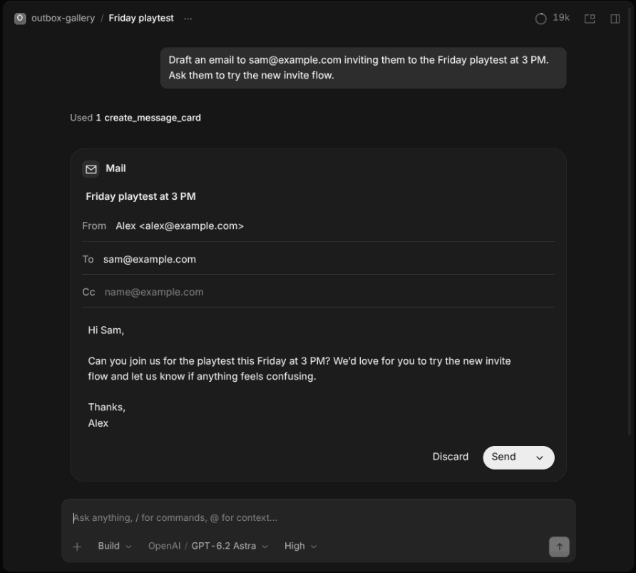

# OpenCode Outbox

## Install

```sh
opencode plugin add github:abran-labs/opencode-outbox
```

## Message cards

Ask your agent to draft a message. Edit the draft directly on its local card. Send it.



| Action | What it does |
| --- | --- |
| Send | Asks the agent to deliver your exact draft through its usual messaging MCP. (e.g. https://github.com/taylorwilsdon/google_workspace_mcp) |
| ＋ tile | Choose, drop, or paste files. Images and SVGs render inline; click a PDF, audio, or video tile to open it in OpenCode’s file viewer. |
| Rewrite | Rewords the draft in place, keeping its attachments. |
| Copy | Copies the message text and closes the editor with a **Copied** receipt. Use the inline copy icon to keep editing. |
| Discard | Closes the draft without sending it. |

## Uninstall

```sh
opencode plugin remove github:abran-labs/opencode-outbox
```
