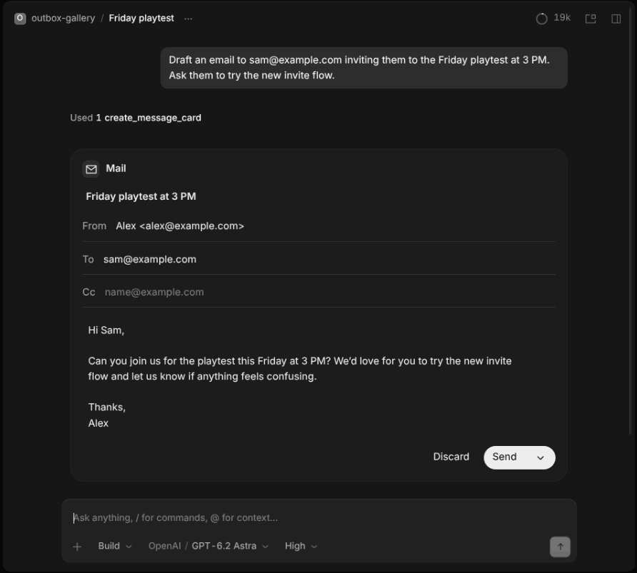

# OpenCode Outbox

## Install

```sh
opencode plugin add github:abran-labs/opencode-outbox
```

## Message cards

Ask your agent to draft a message. Edit the draft directly on its local card. Send it.



View a still: [Email](.github/assets/chat/mail.png) · [Discord channel](.github/assets/chat/discord.png) · [Group reply (design preview)](.github/assets/chat/group-reply.png) · [Telegram](.github/assets/chat/telegram.png)

In the group reply preview, **To** is the group chat, **Replying to Sam** quotes the message being answered, and **@Maya** stays in the draft itself.

For a browser chat or another custom destination, ask “Draft a message for the support chat that I can copy and paste.” The card uses the destination name, a generic chat icon, and **Copy**. No messaging connector is needed.

| Action | What it does |
| --- | --- |
| Send | Asks the agent to deliver your exact draft through its usual messaging MCP. (e.g. https://github.com/taylorwilsdon/google_workspace_mcp) |
| Send ▾ | **Disable drafts** skips Outbox review for explicit send requests across sessions and agents. **Allow recipient** limits that shortcut to a recipient. Asking for a draft always creates one. |
| Copy | Copies your exact draft to your clipboard. |
| Discard | Closes the draft without sending it. |

## Uninstall

```sh
opencode plugin remove github:abran-labs/opencode-outbox
```
